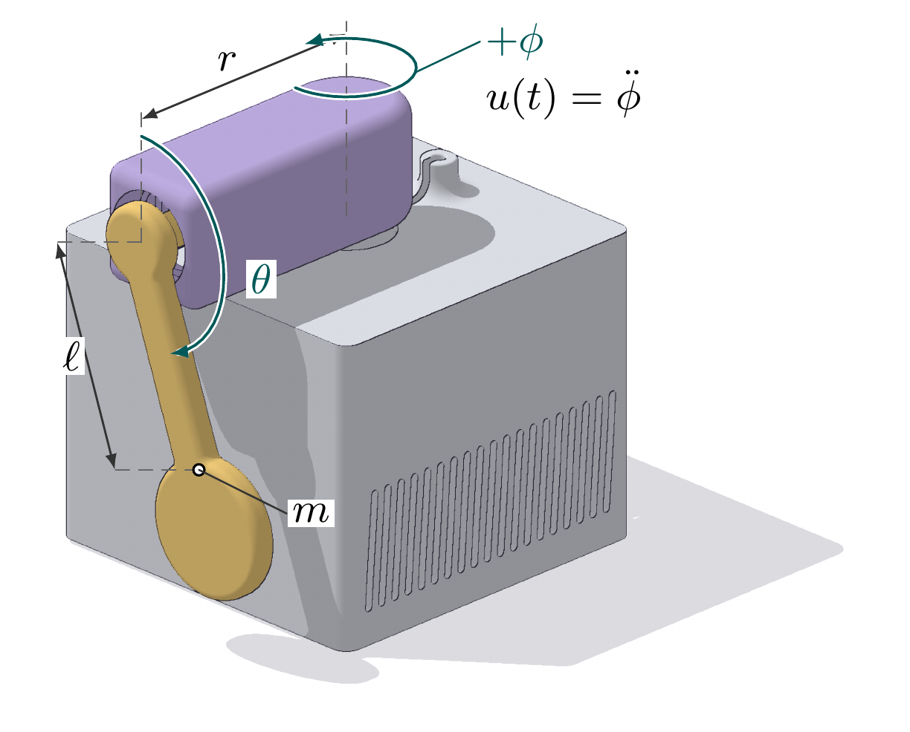

# HW1: Build and Control a Rotary Inverted Pendulum

<p align="center">
  
</p>

- Build and identify your own physical pendulum.
- Implement PID, LQR, iLQR, MPC, PPO, SAC and DQN.
- Run every algorithm in simulation and in attended hardware trials, and compare them.
- Explore your own ideas in the optional `custom.py` file.

## Workflow

1. Read the [assignment](docs/assignment.md) and install the tools below.
2. Follow [assembly and wiring](docs/hardware.md).
3. Get a TA hardware check; complete the [commissioning checks](docs/deployment.md).
4. Run the supplied [system-identification tools](docs/system-identification.md) on your own experiments.
5. Implement and evaluate your algorithms in simulation.
6. Deploy every algorithm on your rig using the [deployment checklist](docs/deployment.md).
7. Write `Report.md` and submit your repository (see [Submission](#submission)).

**The supplied model parameters are uncalibrated placeholders. Identify your own.**

## Install

- Python 3.11+ with `pip` and `venv`.
- Linux is the primary lab platform.
- Internet access is needed for dependencies and firmware tools.
- Run these commands from the directory containing this README:

```bash
python3 -m venv .venv
source .venv/bin/activate
python -m pip install -e '.[dev,rl,firmware]'
python -m unittest discover -s tests
pendulum-lab sim --algorithm zero --duration 1 --output runs/smoke
```

- Dependencies: [pyproject.toml](pyproject.toml).
- Included: NumPy, SciPy, MuJoCo, Gymnasium, PySerial, PyTorch, Stable-Baselines3 and test tools.
- PlatformIO downloads board tools and firmware libraries on the first build.
- The `zero` smoke test needs no hardware and does not balance.
- Minimal install: `pip install -e .` omits PyTorch, Stable-Baselines3 and firmware tools.
- USB permissions and firmware uploads: [deployment guide](docs/deployment.md).
- Versions are bounded, not locked. Record your environment for submission:

```bash
python -m pip freeze > environment.txt
```

## Project Layout

```text
src/pendulum_lab/
  algorithms/        Seven required algorithms and optional custom.py
  plant/             Physics, transport, reward and starter parameters
  contracts.py       Observation and action definitions
  environment.py     Simulation and reset conditions
  serial_client.py   USB protocol
  hardware.py        Commissioning and attended control loop
  sysid_core.py      Supplied peak-envelope fit and friction derivation
  sysid_wizard.py    Tare, repeated trials, motor check and comparison plots
  sysid_accel.py     Acceleration step/chirp capture and simulator replay
  motor_envelope_probe.py       Feedback-driven motor response experiments
  fit_motor_envelope_coupling.py Driven coupling regression
  evaluation.py      Shared metrics
  media.py           Simulator GIF export
  cli.py             Command-line entry point
firmware/            Heartbeat, encoder test and low-level server
hardware/            Printable parts and component images
docs/                Assignment, assembly and deployment guides
tests/               Infrastructure tests
```

## Your Code

- Edit files in [algorithms/](src/pendulum_lab/algorithms).
- Required: `pid.py`, `lqr.py`, `ilqr.py`, `mpc.py`, `ppo.py`, `sac.py`, `dqn.py`.
- Optional: [custom.py](src/pendulum_lab/algorithms/custom.py) for your own approach.
- Implement `Controller.reset()` and `Controller.act(observation)`.
- PPO, SAC and DQN also need `train(env_factory, config, output_dir)`.
- The custom file has an optional training hook.
- Keep each algorithm and its helpers, including any swing-up logic, in its provided `.py` file.
- Swing-up: PID, LQR, iLQR and MPC may use any swing-up logic, even hard-coded, to reach upright.
  The graded algorithm must do the balancing. Describe the swing-up in `Report.md`.
- PPO, SAC and DQN get no swing-up helper; the learned policy swings up and balances.
- PPO, SAC and DQN may use any deep-RL library. Stable-Baselines3 is recommended and installed.
- Classical controllers: derive A and B yourself. Numerical libraries (linear algebra, Riccati solvers, optimizers) are fine.
- Need another package? Ask the TA in the Discord hw1 channel first, then document its installation in this README.
- Keep using the supplied shared infrastructure.
- TODO stubs raise `NotImplementedError`; no solutions or trained policies are supplied.

## System Identification

- The complete tare, recording, fitting and validation workflow is supplied.
- You perform the experiments, check the CAD geometry against your rig, and assess model quality.
- Keep 12 V off for free-swing recording; secure the arm mechanically.
- The optional powered motor sweep has a separate preflight and confirmation.
- Follow the [experiment instructions](docs/system-identification.md).
- Record a video of your identification process for `Report.md`.
- Export your own `configs/my_rig.json`; no instructor measurements are bundled.
- The kit pendulum carries an NT$10 coin; put your weighed pendulum mass in that JSON (see the guide).
- Friction uses CAD geometry; period-derived inertia is also reported.
- Supplied driven-response tools cover step/chirp replay, motor-envelope checks and coupling fitting.
- These experiments do not automatically identify motor torque or transport delay.

## Control Interface

- Rate: **50 Hz** (one step every 0.02 seconds).
- Output: one normalized action in **[-1, 1]**.
- Command: arm acceleration in **[-50, 50] rad/s^2**.
- Arm travel: **+/-100 degrees**, with a stop at either boundary.
- Arm speed: capped at **5 rad/s** by the stepper planner, in simulation and firmware.
- Hardware runs: up to **30 seconds** (`--duration`), the length of a demo run.
- Observation: **four stacked frames**, 24 values total.
- Action smoothing: **none**.
- Full definitions: [assignment interface](docs/assignment.md#controller-interface).
- Custom methods use the same interface and hardware safety checks.

## Run Your Implementation

- Complete the relevant TODOs before running these examples.
- Replace `configs/my_rig.json` with your identified parameter file.
- Use a new output directory for every run.
- `policy.pt` is an example name; you choose the checkpoint format.
- Simulation is headless by default. Add `--render` on a graphical desktop.
- Add `--gif` to save `episode_NNN.gif` next to each trace for `Report.md`.
  It renders offscreen; without a display, set `MUJOCO_GL=egl` (or `osmesa`).

```bash
# Near-upright LQR evaluation
pendulum-lab sim --algorithm lqr --params configs/my_rig.json \
  --start upright --episodes 10 --output runs/lqr

# Hanging-start LQR run with a GIF for the report
pendulum-lab sim --algorithm lqr --params configs/my_rig.json \
  --gif --output runs/lqr_gif

# PPO training and evaluation
pendulum-lab train --algorithm ppo --params configs/my_rig.json \
  --start mixed --config configs/example.json --output runs/ppo_train
pendulum-lab sim --algorithm ppo --params configs/my_rig.json \
  --checkpoint runs/ppo_train/policy.pt --episodes 50 \
  --seed 10000 --output runs/ppo_eval

# Your own method
pendulum-lab sim --algorithm custom --params configs/my_rig.json \
  --output runs/custom_eval
```

- Use `--algorithm custom` with `train` if your method needs training.
- Use `--algorithm custom` with `hardware` after simulation and commissioning.
- Follow the deployment guide before any powered run.

## Submission

- Deadline: **2026/11/6 (Fri.) 23:59 GMT+8**. Each late day multiplies the score by 0.9; no grace days.
- Create your repository from this template in the `RPL-fall-2026` organization.
- Name it `RPL-hw1-group{xx}` and add your group members as contributors.
- Submit the repository link to NTU COOL Homework 1. The TAs clone your **main branch**.
- Write your report in `Report.md` at the repository root.

### What `Report.md` must cover

Baseline (80%):

- Assembly (10%).
- System identification (15%): a video of your identification process, plus the results.
- Algorithms (50%):
  - Swing-up logic for the classical controllers (7%).
  - For each of the seven algorithms, a side-by-side simulator GIF and real-pendulum video,
    with detailed metrics (5% x 7).
  - At least one successful algorithm from each category, classical and learning-based (4% x 2).
- AI usage and reflection (5%):
  - Representative AI interactions from the project (2.5%).
  - What you learned, what AI helped with, and how you verified or corrected its suggestions (2.5%).

Advanced challenge (20%):

- Success with every algorithm (10%).
- Live demo at the Monday 11/9 lecture (10%): two 30-second runs of your best algorithm on
  your pendulum. TAs score swing-up time, balance duration and robustness to external
  perturbations. The top 20% of teams receive full credit.

Success means the full-task metric in the [assignment](docs/assignment.md#experiments-and-submission).

### Commit your final checkpoints

`.gitignore` excludes `runs/`, `*.pt`, `*.zip` and `*.pkl` so experiments do not bloat the
repository. The TAs only see what you commit:

- Commit the final checkpoint of each learned controller, plus every file `Report.md` links to.
- Either move them out of the ignored paths or force-add them: `git add -f runs/ppo_train/policy.pt`.
- Check with `git status --ignored` before the deadline that nothing you need is still ignored.
- GitHub rejects files over 100 MB; link long videos instead of committing them.

## References

- These papers are starting points, not ready-made solutions for this rig.
- Choose your own implementation details and justify your decisions.
- Paper experiments are not a hardware test procedure; follow the lab checklist.

- **PID:** Ziegler and Nichols (1942).
  [Optimum Settings for Automatic Controllers](https://doi.org/10.1115/1.4019264).
- **LQR:** Kalman (1960).
  [Contributions to the Theory of Optimal Control](https://boletin.math.org.mx/pdf/2/5/BSMM%282%29.5.102-119.pdf).
- **iLQR:** Li and Todorov (2004).
  [Iterative Linear Quadratic Regulator Design for Nonlinear Biological Movement Systems](https://doi.org/10.5220/0001143902220229).
- **MPC:** Mayne, Rawlings, Rao and Scokaert (2000).
  [Constrained Model Predictive Control: Stability and Optimality](https://doi.org/10.1016/S0005-1098%2899%2900214-9).
- **PPO:** Schulman et al. (2017).
  [Proximal Policy Optimization Algorithms](https://arxiv.org/abs/1707.06347).
- **SAC:** Haarnoja et al. (2018).
  [Soft Actor-Critic: Off-Policy Maximum Entropy Deep Reinforcement Learning with a Stochastic Actor](https://arxiv.org/abs/1801.01290).
- **DQN:** Mnih et al. (2015).
  [Human-level Control through Deep Reinforcement Learning](https://doi.org/10.1038/nature14236).
